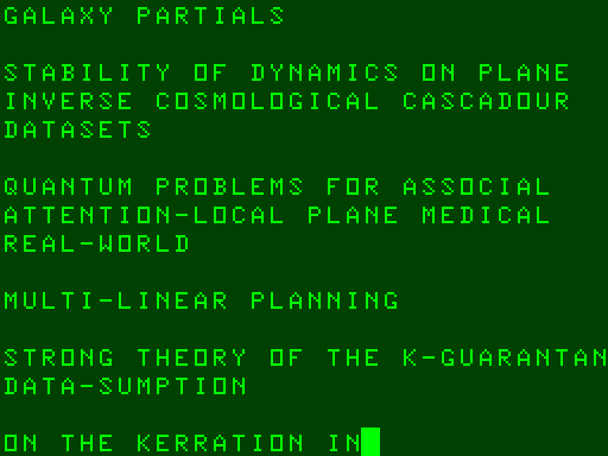
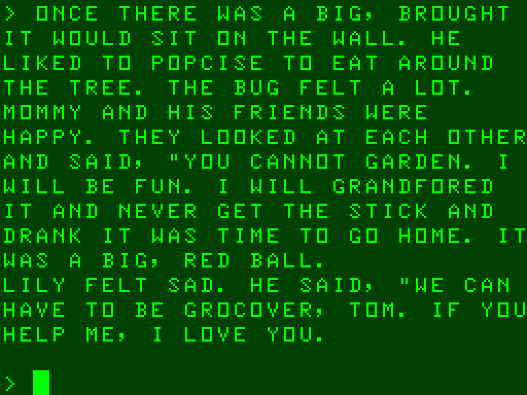

# tiny-gpt

Transformer language models that run on the KiT. Each one is 55k 4-bit parameters that
stream straight from 8 SSD sectors. There are two:

- `titles`, trained on 2.9 million [arXiv](https://arxiv.org) paper titles, makes up papers:

  

  ```
  exact image simulation of the long-aware-way post-matrices
  counterource stars molecular kondoscopic correlation of monte carlo joints
  general correlation of the classification of security matter of pixel biases in two-level estimating
  similarity of a quantum diverse for statistics of the field
  a spin-based novel control
  the x-ray dimensions for the series representation learning
  ```

- `stories`, trained on [TinyStories](https://huggingface.co/datasets/roneneldan/TinyStories),
  writes simple children's stories. Here it is continuing "once there was":

  

Type a prompt, or nothing, and press enter. The model continues it one token (about 2
characters) at a time, at about 1.8 seconds per token. With no prompt, `titles` keeps writing
new titles until you press esc. Esc stops the model; esc at the prompt returns to the monitor.

## The models

| | |
| --- | --- |
| Parameters | 55k, stored as 4-bit integers |
| Layers | 2 transformer blocks, model width 56 |
| Attention | 4 query heads of size 14 sharing one key/value head, learned relative-position bias, 32-token window |
| Feed-forward | 112 hidden units, ReLU |
| Vocabulary | 256 tokens: the characters plus BPE merges, lowercase |
| Storage | data file `<model>-weights`, 8 SSD sectors (29.7 KB) |
| Program | `<model>.prg`, 7.6 KB at `$1000` (2 sectors) |
| Quality | `titles`: 1.83 bits per character, `stories`: 1.34, on held-out text |

The weights never leave the SSD: the program reads each matrix straight out of the
`$8000-$8fff` window, one sector at a time. Each sector is a normal KSF data-file sector,
so the weights show up in the file manager (`f`) and BASIC won't write over them. Both models can be
on the SSD at once.

Everything is integer arithmetic. Each weight matrix is multiplied one column at a time: for
input `x`, the program builds a 16-entry table of `(w - 8) * x` and then adds one table entry
per 4-bit weight, about 32 cycles per multiply-add. Activations are 8-bit, the residual
stream is 16-bit, and RMS norm, softmax and sampling use lookup tables (`1/sqrt`, `exp`) and
quarter-square multiplication. `kitsim.py` does exactly the same arithmetic in Python, and
`test_emu.py` checks that the KiT produces the same tokens.

## Install

Each model's files are in `build/<model>/`. On the KiT, load each of these with the monitor's
`l` command and choose `r`, in order:

1. `install1.prg`: removes earlier weights for this model, picks the lowest run of 8 free
   sectors, and writes the first 4
2. `install2.prg`: writes the other 4

Then load `titles.prg` (or `stories.prg`) with `l` and choose `r` to run it, or `s` to save it
to the SSD and run it later with `f`.

In kit-emu, with the emulator closed:

```sh
make MODEL=titles emu-install     # weights and program into kit-emu/ssd.bin
```

It prints the sector to run with `f`, for example `f 21`.

## Settings

`models/<model>/settings.inc` holds each model's intro text and sampling settings:

| Setting | `titles` | `stories` | |
| --- | --- | --- | --- |
| `TEMP_MUL` | 341 | 384 | temperature is `256 / TEMP_MUL` |
| `CUTOFF` | 10 | 20 | drop tokens less than `CUTOFF / 255` as likely as the best one |
| `MAX_TOKENS` | 90 | 250 | longest title or story |
| `STREAM` | 1 | 0 | with no prompt, keep going until esc |

Higher temperature and a lower cutoff give stranger, less coherent text. Run `make` after
changing them.

## Train your own

Training runs on the CPU. On an Intel Mac, PyTorch 2.2.2 with Python 3.12 is the newest that
installs:

```sh
python3.12 -m venv .venv
.venv/bin/pip install "torch==2.2.2" "numpy<2" "pyarrow==17.0.0"
```

Get the text. For titles, download the 11 parquet files of the
[arXiv metadata snapshot](https://huggingface.co/datasets/librarian-bots/arxiv-metadata-snapshot)
(CC0, 2.7 GB) into `data/arxiv/`:

```sh
mkdir -p data/arxiv && cd data/arxiv
for i in 00 01 02 03 04 05 06 07 08 09 10; do
  curl -LO https://huggingface.co/datasets/librarian-bots/arxiv-metadata-snapshot/resolve/main/data/train-000$i-of-00011.parquet
done
cd ../..
.venv/bin/python prep.py --titles                                  # data/titles-{train,val}.txt
.venv/bin/python prep.py --corpus titles --tok bpe --vocab 256     # tokenizer + encoded data
```

For stories, download `TinyStoriesV2-GPT4-train.txt` and `TinyStoriesV2-GPT4-valid.txt` from
[TinyStories](https://huggingface.co/datasets/roneneldan/TinyStories/tree/main) into `data/`, then
run `prep.py --chars 600000000` and `prep.py --tok bpe --vocab 256`.

Train (`--tok bpe256` for stories):

```sh
.venv/bin/python train.py --name mine --tok titles-bpe256 --d 56 --head-dim 14 --layers 2 \
    --ff 112 --inner-gain 0 --qat-start 0 --minutes 50 --threads 6
```

`train.py` trains with 4-bit weights from the start (quantization-aware training with learned
per-row scales). It prints validation bits per character as it goes, saves `runs/NAME/last.pt`
along the way, and writes `runs/NAME/model.pt` and a sample at the end. `--init
runs/NAME/last.pt` continues from a checkpoint.

To make it a model of its own, copy the checkpoint to `models/<name>/model.pt`, copy a
`settings.inc` next to it, and build:

```sh
make MODEL=mine export     # build/mine/model.inc, weights.bin, ...
make MODEL=mine            # build/mine/mine.prg, install1.prg, install2.prg
make MODEL=mine test       # run in kit-emu and compare with kitsim.py
```

The program is assembled for one set of weights (shift amounts and stream positions are
constants in `build/<model>/model.inc`), so rebuild it whenever you export new weights. It
refuses to run with weights that don't match.

`kitsim.py` scores the integer model and prints samples:

```sh
.venv/bin/python kitsim.py models/titles/model.pt --eval 100 --sample 5 --len 60
```

## Files

| File | What it does |
| --- | --- |
| `tinygpt.asm` | the KiT program |
| `install.asm` | installer, one part per 4 sectors of weights |
| `models/<model>/` | trained weights (`model.pt`) and `settings.inc` |
| `build/<model>/` | programs, installers and packed weights |
| `prep.py` | text normalization and the character/BPE tokenizers |
| `train.py` | model and training |
| `kitsim.py` | integer model, bit-exact with the KiT |
| `export.py` | packs weights into SSD sectors and writes `model.inc` |
| `pack.py` | writes a model (and its program) into an SSD image |
| `test_emu.py` | runs the program in kit-emu headless and compares with `kitsim.py` |
| `debug_emu.py` | compares the KiT's activations with `kitsim.py` stage by stage |

## Memory

| Range | Use |
| --- | --- |
| `$0300-$0aff` | quarter-square tables |
| `$0b00-$0cff` | multiply table for the current input |
| `$0d00-$0fff` | activations |
| `$1000-$2dff` | program |
| `$3000-$30ff` | prompt |
| `$3100-$39ff` | row scales, attention biases and BPE merges, copied from the SSD |
| `$3a00-$41ff` | attention keys and values |
| `$4200-$45ff` | key sums, logits, sampling weights |
| zero page `$40-$ff` | accumulators and variables |
